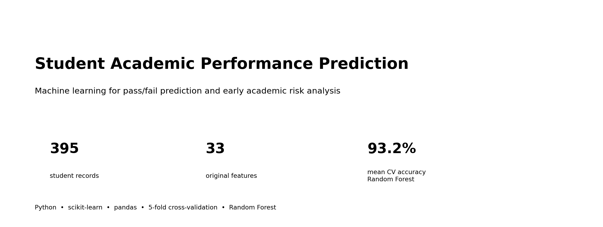
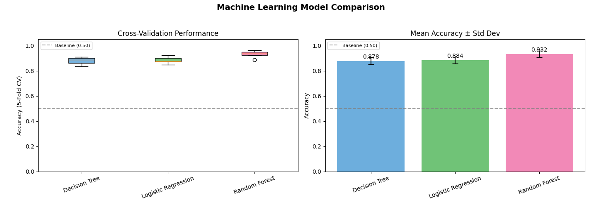

<p align="center">
  
</p>

# Student Academic Performance Prediction | From Machine Learning to Decision Support

**Can we predict which students may struggle academically and, more importantly, can those predictions help a school decide whom to support?**

This project began with a traditional machine learning question: *Can models predict final academic outcomes from student data?* After training and comparing classifiers, we extended the work to a harder, more practical question: *If advisors have limited time, does machine learning help them identify students for review better than a simple, understandable rule?*

Our answer is deliberately evidence-based. **Predictive accuracy improved once earlier grades were available, but simple grade-based rules were highly competitive for selecting students under a limited review capacity.** The project therefore illustrates both what ML can do and when an organization should question whether it needs a more complex solution.

> **Scope:** Educational research demonstration using historical records not a deployed student advisory system. No institution implemented these predictions, and no intervention outcomes were measured.

## 1. The problem we wanted to solve

A final-grade prediction is useful only if it arrives in time to inform an action. Advisors might want to identify students who need a conversation, tutoring, or a review of their academic progress. But they cannot necessarily review everyone at once.

We investigated two decisions:

1. **Timing:** How does the ability to identify academic risk change when first-period (`G1`) and second-period (`G2`) grades become available?
2. **Prioritization:** If advisors can review only **20% of students (79 of 395)**, which method finds more students who eventually finish below the project's benchmark-Logistic Regression, Random Forest, or a simple rule?

These are **hypothetical decision scenarios**, not evidence of a real school workflow or improved grades.

## 2. The data and the definition of academic risk

- **Data:** 395 historical student records with 33 original variables covering academic and contextual information.
- **Outcome:** `G3/label_y` (final grade) **below 12 out of 20** is labeled "below benchmark" (**233 students**); **162** scored 12 or above.
- **Important:** 12/20 is a **project-chosen threshold**, not an established official passing standard for the source school.
- **Inputs for the extension:** Selected survey attributes, then first-period grade (`G1`), then `G1` plus second-period grade (`G2`). Total absences were excluded because their collection timing cannot be established from this data.

The survey-only stage is **provisional**: the dataset does not verify when every survey response was collected. We cannot claim the model would work at enrollment or during a specific early-semester week.

## 3. What the original machine learning study established

Our [original team notebook](notebooks/student_performance_prediction.ipynb) cleaned and explored the data, trained multiple models, compared performance, and examined factors associated with the final result. **That notebook is preserved unchanged** as the original project record.

| Original model | Mean 5-fold CV accuracy |
|---|---:|
| Decision Tree | 87.8% |
| Logistic Regression | 88.4% |
| **Random Forest** | **93.2%** |



The earlier grades (`G1`, `G2`) were important predictors. But the original study alone did not establish **how early** risks could be identified, whether prediction errors were acceptable for student support, or whether the model improved an advisor's decision.

That is why we added a separate **Decision Support** phase instead of rewriting the original notebook.

## 4. What we tested in the Decision Support extension

We compared **Logistic Regression** and **Random Forest** across three information stages, using five-fold **stratified cross-validation**. Preprocessing was fitted inside each training fold; each student's evaluation prediction came from a model that was not trained on that student's row.

| Information available | Random Forest accuracy | Recall of below-benchmark students |
|---|---:|---:|
| Provisional survey-only stage | **62.0%** | **71.7%** |
| After first-period grades (`G1`) | **88.6%** | **91.4%** |
| After second-period grades (`G2`) | **92.9%** | **94.0%** |


**Finding:** Once earlier academic grades were available, the models became substantially more accurate. But later, more accurate predictions may provide less time for a school to intervene. The survey-only model was considerably weaker, so we cannot claim reliable early-semester detection based on these results.

### Why accuracy isn't the full story

After G2, the Random Forest achieved **92.9% accuracy** with **14 missed-risk cases** and **14 false alarms** at a 0.5 risk-probability threshold. Missed-risk cases are students who finished below 12 but were not flagged; false alarms are students flagged even though they finished at or above 12.

Our majority-class baseline flagged **everyone** as at risk. Its risk recall was **100%**, but it also falsely flagged **all 162 students** who scored 12 or above, for only **59.0% overall accuracy**. This is why we evaluate precision, recall, mistakes, and resource constraints not accuracy or recall in isolation.

## 5. Does ML actually help advisors choose whom to review?

We simulated a school that can review **79 of the 395 students** and ranked students by each model's predicted risk or a straightforward rule. The table reports how many students who **ultimately scored below 12** were among those 79 selections.

| When a review takes place | Logistic Regression | Random Forest | Simple ranking rule |
|---|---:|---:|---:|
| Provisional survey stage | 65 | 65 | 65 |
| After G1 | **79** | 76 | 78 |
| After G2 | **79** | 78 | **79** |

The simple rules used previous failures and study time for the provisional stage, lowest `G1` after the first grading period, and lowest `G2` after the second.


**What the comparison means:** A simple rule was nearly as effective as, or matched, the tested ML approaches for this particular ranking task. The highest-accuracy model was not always the best model for choosing whom to review first. Equal totals do not mean the methods necessarily selected the same students.

**An essential distinction:** Selecting **79 below-benchmark students among 79 reviews** is **100% precision in that review queue**. But it identifies only **79 of all 233 below-benchmark students-33.9% coverage**. Another **154** remain outside the first 79 reviews. We have **not** found every student at risk, and a 79-person review simulation is not the same thing as predicting every student's class at a 0.5 threshold.

This is a retrospective simulation. It does not establish that the 78-versus-79 differences will persist with future students, or that any review would have improved grades.

## 6. Our recommendation: use evidence to choose the solution

**Based on this dataset and the simulated review limit, start by evaluating a transparent grade-based review process rather than immediately paying to deploy a more complex ML model.** It is easier for advisors to understand, and ML has not demonstrated a consistent advantage for this particular decision.

If an institution considers an ML system, it should first:

- Validate predictions on new, time-stamped student cohorts and establish when features are genuinely available.
- Compare ML with simple rules using missed-risk cases, review-queue coverage, costs, and advisor capacity not just accuracy.
- Examine errors across relevant groups and address permissions, privacy, and potential unfairness.
- Keep educators responsible for support decisions and measure whether interventions actually improve outcomes.

**We did not implement or measure those real-world interventions.** This project demonstrates how to *evaluate* a decision, not that student success was improved.

For detailed tables, evaluation methods, error counts, and limitations, see **[Decision Support Results](reports/DECISION_SUPPORT_RESULTS.md)**.

## 7. How the work was built

`Problem → data quality checks → predictive models → staged validation → compare mistakes and simple rules → simulate limited advisor capacity → recommendation → local inference test`

| Project component | Purpose |
|---|---|
| [Original prediction notebook](notebooks/student_performance_prediction.ipynb) | Original preserved research: exploratory analysis, classifiers, feature importance, and related experiments. |
| [Decision Support notebook](notebooks/decision_support_analysis.ipynb) | Second-phase analysis of prediction timing, out-of-fold evaluation, model errors, and advisor-review rankings. |
| [Decision-support results report](reports/DECISION_SUPPORT_RESULTS.md) | Numerical evidence, conclusions, cautions, and possible next actions. |
| [`decision_support.py`](decision_support.py) | Shared data preprocessing, modeling, validation, and inference functions. |
| [`scripts/generate_results.py`](scripts/generate_results.py) | Recreates the results CSV, charts, and saved local inference model. |
| [`scripts/test_inference.py`](scripts/test_inference.py) | Tests local model inference and request handling. |
| [`models/academic_risk_pipeline.joblib`](models/academic_risk_pipeline.joblib) | Research example pipeline for **local testing**, not a deployed student tool. |
| [`local_inference.py`](local_inference.py) | Loads the saved pipeline, validates example inputs, and returns predictions completely offline. |
| [`scripts/local_inference_demo.py`](scripts/local_inference_demo.py) | Runs a fictional student example through local inference; not an independent evaluation. |

**A note on the two model scores:** The original **93.2%** and second-phase **92.9%** Random Forest results come from **different inputs and evaluation procedures**. They are not a before-and-after accuracy improvement or an identical reproduction. In addition, the original notebook uses **1 = at or above 12**, while the Decision Support phase uses **1 = below 12**, so class-specific metrics must be interpreted accordingly.

The saved model is trained on the research dataset following cross-validation and is provided only for demonstrating local software inference. It has **no independent external validation**. Original presentation slides and the PDF project report are retained as historical artifacts; some early-warning interpretations are qualified by the newer decision-support analysis.

### Running and reproducing the analysis

From the project root, create a Python virtual environment:

```bash
python -m venv .venv
```

Activate it on **Windows PowerShell** with `.venv\Scripts\Activate.ps1` or on **macOS/Linux** with `source .venv/bin/activate`, then run:

```bash
python -m pip install -r requirements.txt
python scripts/generate_results.py
python scripts/test_inference.py
python scripts/local_inference_demo.py
jupyter notebook notebooks/decision_support_analysis.ipynb
```

The results generator writes `reports/decision_metrics.csv` and the two new charts in `assets/`. You can also run `python scripts/local_inference_demo.py` to test fictional example inputs against the saved local pipeline, without any cloud services. Close `decision_metrics.csv` in Excel before rerunning the generator on Windows if Excel is locking the file.

Do not load untrusted joblib model artifacts. Compatible Python and scikit-learn versions are required to reload saved models.

### Repository map

```text
Student-Academic-Performance-Prediction/
├── assets/
├── data/student_data.csv
├── decision_support.py
├── local_inference.py 
├── models/
├── notebooks/
│   ├── student_performance_prediction.ipynb 
│   └── decision_support_analysis.ipynb
├── presentation/project_presentation.pptx
├── reports/
│   ├── DECISION_SUPPORT_RESULTS.md
│   ├── decision_metrics.csv
│   └── project_report.pdf
├── scripts/
├── requirements.txt
└── README.md
```

## Limitations and responsible use

This is a small, historical dataset from Portuguese secondary-school students, with uncertain survey timing, no independent external test cohort, and no measured interventions. Removing demographic variables does not establish that a model is fair or free of proxies. Results should not be transferred to a different school without fresh validation. The 20% advisor capacity is illustrative, and pooled out-of-fold rankings from different fitted models are exploratory rather than proof of general superiority. Student support decisions should remain with authorized educators, with appropriate privacy safeguards.

**Dataset:** Cortez, P., & Silva, A. (2008), *Using Data Mining to Predict Secondary School Student Performance*; data distributed through [Kaggle](https://www.kaggle.com/datasets/devansodariya/student-performance-data).

## Project team

- Chukwunonyelum Rosalyn Ezeako
- Kavya Kalidindi
- Ruyi Gai

**Supervisor:** Dr. Yu Luo

*The original study demonstrates prediction; the second phase evaluates whether predictions support better decisions. Neither phase establishes real-world student outcome improvements.*
