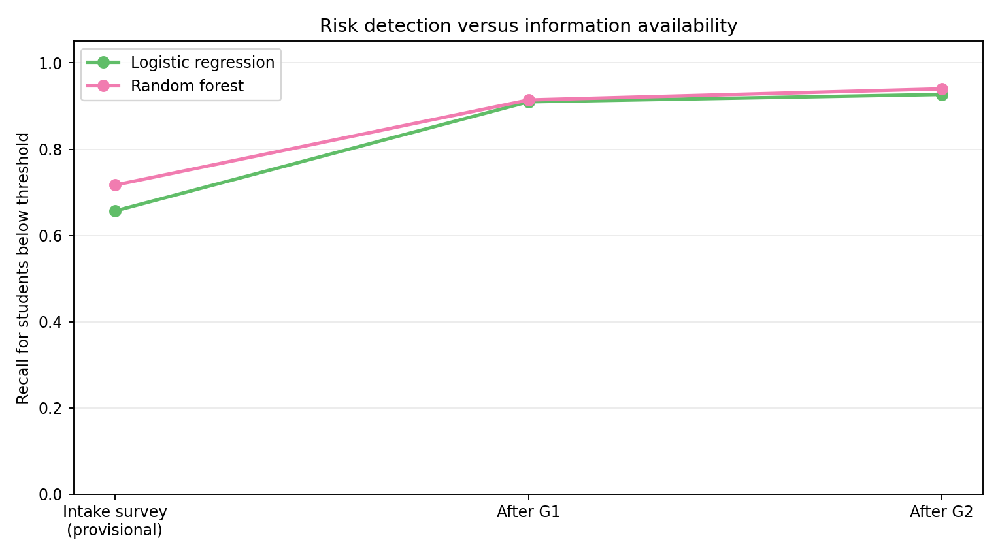
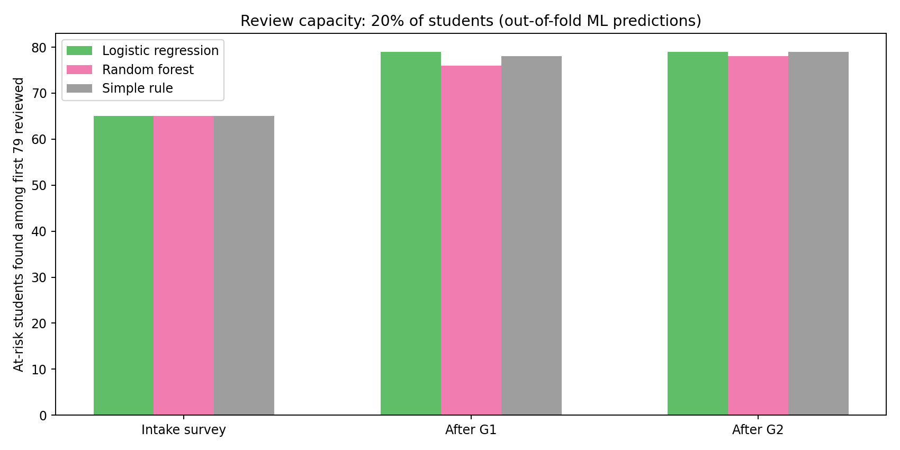

# Decision Support Results Summary

**Student Academic Performance Prediction | Second-phase evaluation**

## Executive finding

In this **395-record academic demonstration**, machine learning predicted the project-defined below-benchmark outcome substantially better **after earlier period grades became available**. But simple, interpretable ranking rules matched or exceeded the tested ML approaches in some fixed-capacity advising scenarios. This means an institution should compare models against simpler alternatives before adopting them.

**Business decision evaluated:** If academic advisors can review only 20% of students, which selection strategy identifies the largest number of students who ultimately finish below a chosen grade benchmark?

**Outcome definition:** Final grade (`G3/label_y`) below **12 out of 20**. This is the team's chosen threshold, **not a verified official pass/fail standard**. **233/395** students were below that threshold; **162/395** met or exceeded it.

## Evaluation protocol

- Five shuffled **stratified cross-validation folds** (random seed 42); each student's model risk estimate was generated while their row was **outside** the fitting fold.
- End-to-end preprocessing in each fold (numeric imputation/scaling as appropriate, categorical imputation and one-hot encoding); no target-derived features in the input.
- Models: majority-class baseline, Logistic Regression and Random Forest with fixed, documented hyperparameters. This is an **exploratory comparison**, not a tuned, independently validated winner.
- Three snapshots: provisional survey inputs, survey plus first-period grade `G1`, and survey plus `G1` and second-period grade `G2`.
- Full-period absences and the final grade are **not available as predictors**. Survey timing in the data is unverified: do not claim the intake model operates at a real specified week.
- The review-capacity scenario selects the top **79 of 395** cases (20%) by ML-predicted risk or an illustrative rule.

## Classification results (out-of-fold)

| Information stage | Method | Accuracy | Risk recall | Risk precision | Missed-risk cases | False alarms |
|---|---|---:|---:|---:|---:|---:|
| Intake survey (provisional) | Majority class | 59.0% | 100.0% | 59.0% | 0 | 162 |
| Intake survey (provisional) | Logistic regression | 60.0% | 65.7% | 66.2% | 80 | 78 |
| Intake survey (provisional) | Random forest | 62.0% | 71.7% | 66.5% | 66 | 84 |
| After first grade | Majority class | 59.0% | 100.0% | 59.0% | 0 | 162 |
| After first grade | Logistic regression | 88.1% | 91.0% | 89.1% | 21 | 26 |
| After first grade | Random forest | 88.6% | 91.4% | 89.5% | 20 | 25 |
| After second grade | Majority class | 59.0% | 100.0% | 59.0% | 0 | 162 |
| After second grade | Logistic regression | 92.2% | 92.7% | 93.9% | 17 | 14 |
| After second grade | Random forest | 92.9% | 94.0% | 94.0% | 14 | 14 |

### Why the majority-class baseline is not a useful advising strategy

The majority-class baseline predicts **every student is below the benchmark**, because 233 of 395 students belong to that group. That gives it **100% risk recall** (no below-benchmark students are missed), but it also flags **all 162 students who actually scored 12 or above**. Its overall accuracy is just **59.0%**. A school with limited advising resources cannot treat every student as equally urgent, so we must consider false alarms, precision, and review capacity-not recall alone.

**How to read the model metrics:** *Accuracy* is the share of all 395 students correctly classified. *Risk recall* is the share of the 233 below-benchmark students identified at the model's 0.5 classification threshold; *risk precision* is the share of students flagged by that threshold who actually finished below 12. **These classification metrics are different from selecting only the 79 highest-risk cases for advisor review**, which we analyze separately below.



## Decision results: who gets reviewed first?

| Stage | Strategy | Below-benchmark students identified among 79 reviews |
|---|---|---:|
| Intake survey (provisional) | Logistic regression | **65 / 79** |
| Intake survey (provisional) | Random forest | **65 / 79** |
| Intake survey (provisional) | Rule: previous failures, then study time | **65 / 79** |
| After first grade | Logistic regression | **79 / 79** |
| After first grade | Random forest | **76 / 79** |
| After first grade | Rule: lowest first-period grades | **78 / 79** |
| After second grade | Logistic regression | **79 / 79** |
| After second grade | Random forest | **78 / 79** |
| After second grade | Rule: lowest second-period grades | **79 / 79** |



### What does 79 out of 79 actually mean?

Two different questions matter when advisors can review only **79 of 395 students**:

| Measure | Example when 79 selected students are below the benchmark | Meaning |
|---|---:|---|
| **Precision within the review queue** | **79 / 79 = 100%** | Every selected student finished below 12/20. |
| **Coverage of all below-benchmark students** (recall at 79 reviews) | **79 / 233 = 33.9%** | The review queue still leaves **154 of the 233** below-benchmark students outside the first round of reviews. |

A perfect 79-person queue is **not** a system that identifies all students who might need help. It is only a successful *ranking under a hypothetical capacity limit*. For example, Random Forest after G2 selected **78/79** below-benchmark students (98.7% queue precision), covering **78/233 = 33.5%** of the below-benchmark group. And equal totals (such as 65/79 at intake) do **not** establish that the strategies selected exactly the same individuals.

### What this comparison does and does not prove

This is a retrospective, hypothetical advising simulation: it does not measure whether any of the selected students received support or improved their grades. ML queue scores are pooled from **out-of-fold predictions across five models fitted on different training folds**; the simple rules use existing variables directly. Small differences such as **78 versus 79** should not be interpreted as dependable superiority without further, time-based or external validation and uncertainty analysis.

**Practical interpretation:** At intake, the simple rule prioritized the same **number** of below-benchmark students as either of the tested models (not necessarily the same individual students). After first-period grades, the simple lowest-grade rule was competitive with both. After second-period grades, the lowest-`G2` rule matched the best tested ML method in this scenario. We **cannot claim ML improves advisor prioritization over simpler methods** on this evidence. A value proposition would require additional prospective or external validation and a clearly demonstrated advantage.

## What action could an institution take?

1. **Consider a transparent review queue first:** At the end of a grading period, identify the lowest-scoring cases for an advisor-led review before implementing a more complex prediction system.
2. **Avoid promises of automatic improvement:** If an ML model is proposed, require a benchmark comparison, risk-group recall, probability quality, subgroup analysis, and documentation of when inputs are available.
3. **Run a real pilot only with governance:** Confirm appropriate student consent/data permissions, have staff review recommendations, and measure whether support produces a real improvement. No real academic intervention occurred in this project.

## Technical results and uncertainty

The second-grade Random Forest had **92.9% accuracy**, **94.0% risk recall**, **14 missed-risk cases**, and **14 false alarms** across out-of-fold predictions. Accuracy alone would hide the costs of those two kinds of error. Probability quality is also explored using Brier score and a calibration plot in the new notebook. These are **not external validation**.

The original notebook reported **93.2%** Random Forest cross-validated accuracy using a different pipeline and input set, including grades and final aggregated absences. The new **92.9%** does not reproduce the identical original experiment; the input features and evaluation procedure intentionally differ.

## Important limitations

- Small historical dataset, originating from Portuguese secondary-school students; results should not be transferred to universities or other schools without new validation.
- Dataset has no reliable feature-collection timestamps and no treatment/outcome data for real interventions.
- A 12/20 cutoff is project-defined and changes the outcome distribution; using another definition would require a new analysis.
- Selected candidate models were evaluated and compared on the same folds; no untouched test set, external dataset, nested model selection or deployment monitoring is included.
- Removing sensitive demographics as predictors does not remove proxies or establish fairness. Descriptive subgroup error comparisons in the notebook are not sufficient for a fairness determination.
- The 20% advising-capacity assumption is hypothetical. A school may have different review capacity, practices, costs, and consequences for false alarms. Review-queue precision and recall should not be confused with classification precision and recall at a 0.5 threshold.
- The exported model was fitted on the full research dataset **after cross-validation**, for local software testing only. It does not have an independent generalization estimate.

## Reproduce the findings

From the project root:

```bash
python scripts/generate_results.py
python scripts/test_inference.py
jupyter notebook notebooks/decision_support_analysis.ipynb
```

Detailed computed figures are in [`decision_metrics.csv`](decision_metrics.csv). The notebook explains each analysis step, displays model errors, and includes a local inference demonstration.
